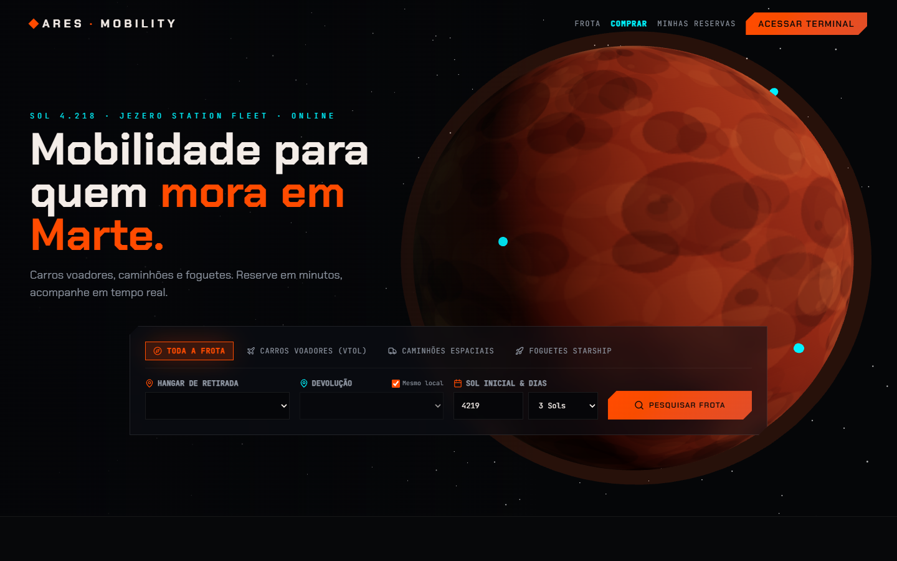
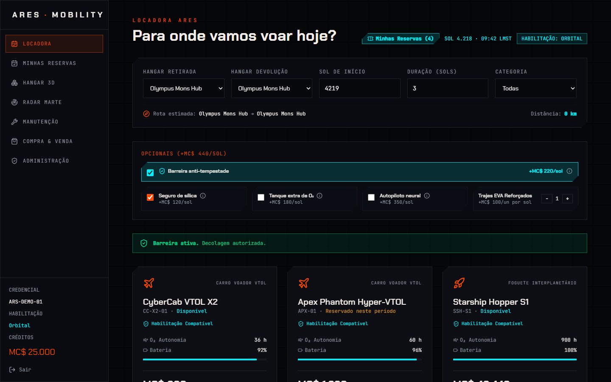
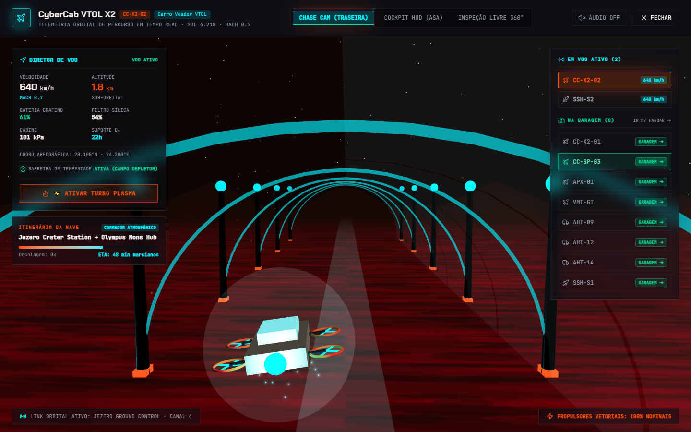
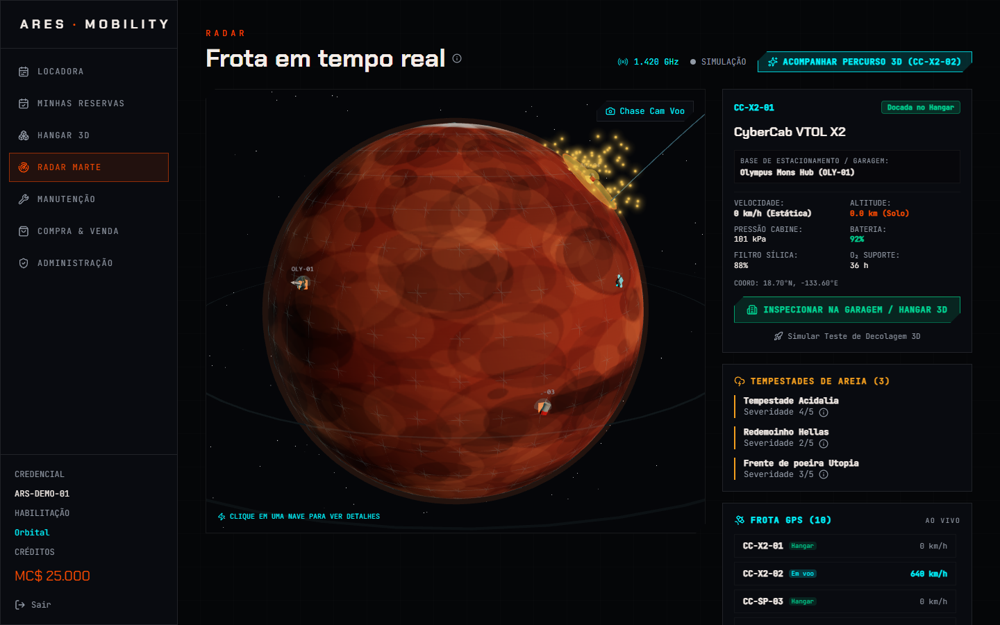
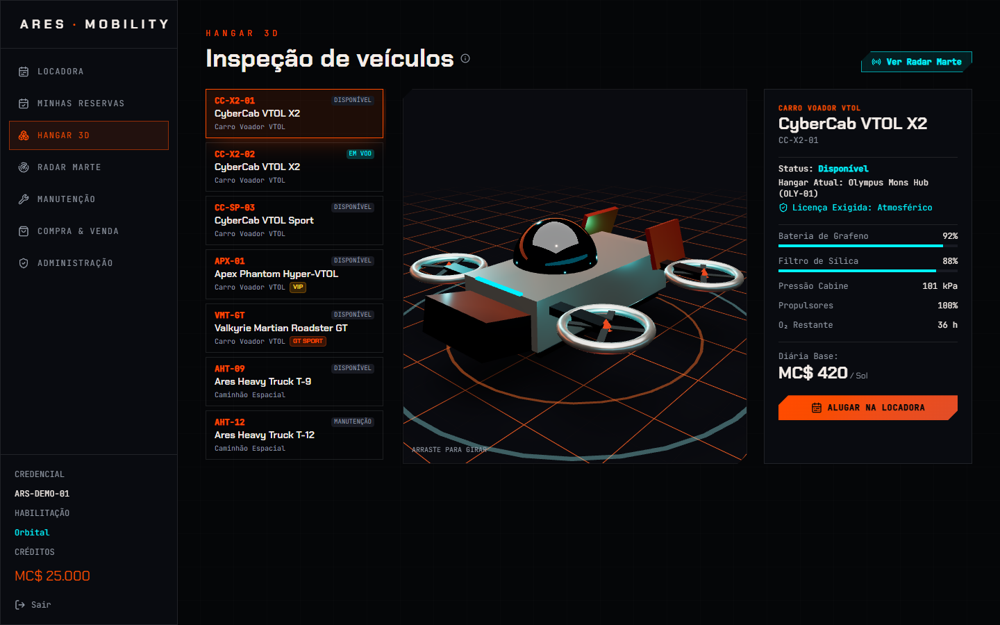
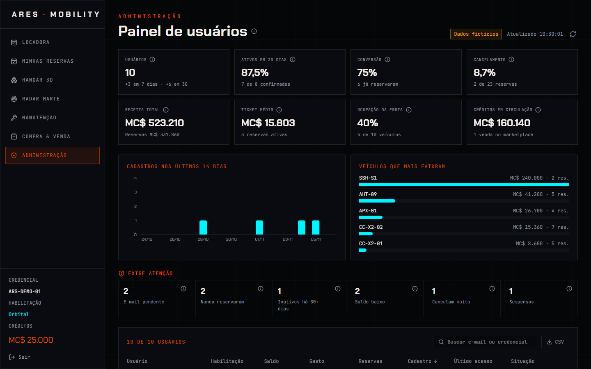

<div align="center">

# ◆ ARES MOBILITY

### Mobilidade para quem mora em Marte.

Alugue, compre e acompanhe carros voadores, caminhões espaciais e foguetes
em uma única plataforma, com a frota em 3D e o clima em tempo real.

`React 19` · `TanStack Start` · `Three.js` · `Fastify` · `Supabase`

[Teste em 2 minutos](#-teste-em-2-minutos) · [Módulos](#-módulos) · [Arquitetura](#-arquitetura) · [Ambiente completo](#-ambiente-completo) · [Testes](#-testes) · [Status](#-status-e-próximos-passos)



</div>

## ◆ Teste em 2 minutos

Precisa apenas do Node.js 22 ou mais novo. Não é preciso criar conta nem configurar banco.

```sh
git clone https://github.com/tarcisiovieira-pixel/product-vision-portal.git
cd product-vision-portal
npm install
cp .env.example .env
npm run dev
```

Abra `http://localhost:8080`, clique em **Acessar Terminal** e depois em **Entrar no modo demo**. O painel administrativo aparece no menu lateral, com dados fictícios.

---

## ◆ A promessa

**Tornar cada cratera de Marte a um voo de distância.**

A ARES une a facilidade de reservar em uma locadora à precisão de um centro de controle espacial: em minutos você escolhe um veículo, reserva e acompanha o voo em 3D.

> Este é um projeto conceito. Marte, os créditos (MC$) e a frota são fictícios. O software é real: autenticação, banco de dados, API, regras de negócio e testes.

## ◆ A dor

|     | Problema                      | O que acontece hoje                                            |
| --- | ----------------------------- | -------------------------------------------------------------- |
| 🌪️  | **Tempestades imprevisíveis** | Rotas somem sob a poeira e colonos ficam presos sem aviso.     |
| 📡  | **Frota sem visibilidade**    | Ninguém sabe onde está cada veículo nem quanto oxigênio resta. |
| 📋  | **Reservas analógicas**       | Rádio e planilha de papel: alugar um foguete levava dias.      |

## ◆ A solução

Um só portal para **reservar, rastrear e cuidar da frota**.

- **Reserva guiada**, com validação de habilitação, saldo e clima antes de confirmar.
- **Frota viva em 3D**: radar de Marte, hangar e acompanhamento de voo.
- **Regras no servidor**: preço e permissões são decididos no backend, não na tela.

## ◆ Módulos

### Disponíveis

| Módulo                       | O que faz                                                                                                           |
| ---------------------------- | ------------------------------------------------------------------------------------------------------------------- |
| 🚀 **Locadora**              | Busca por hangar e categoria, opcionais, cálculo de custo e reserva.                                                |
| 🎫 **Minhas Reservas**       | Lista, filtros, chave quântica, estender e cancelar com reembolso.                                                  |
| 🛰️ **Radar Marte**           | Globo 3D com a frota em movimento, tempestades e rotas.                                                             |
| 🛩️ **Voo 3D**                | Acompanhamento em câmera traseira, cockpit ou 360°, com turbo e áudio.                                              |
| 🏗️ **Hangar 3D**             | Inspeção de cada veículo pairando no pad, com dados técnicos.                                                       |
| 🔧 **Manutenção**            | Saúde da frota, diagnóstico por pontos no modelo 3D e ordens de serviço.                                            |
| 🛒 **Marketplace**           | Compra de naves e publicação de anúncios.                                                                           |
| 🔐 **Contas e demo**         | Cadastro com confirmação por e-mail, login, troca de senha no app, recuperação por e-mail e modo demo sem cadastro. |
| 🛡️ **Painel administrativo** | Indicadores do negócio, gestão de usuários, suspensão, ajuste de créditos, exportação e auditoria.                  |

### Programados

| Módulo                            | O que vai fazer                                                                   |
| --------------------------------- | --------------------------------------------------------------------------------- |
| 🤖 **Copiloto de bordo (IA)**     | GPS com assistente de voz e texto: rota, clima e alertas em linguagem natural.    |
| 📊 **Relatórios com IA**          | Resumo de custos, uso da frota e sugestões, gerado sob demanda.                   |
| 🔮 **Manutenção preditiva**       | Previsão de falhas a partir da telemetria dos veículos.                           |
| 🧭 **Centro de comando**          | Painel inicial com tudo o que importa ao piloto.                                  |
| 🎯 **Missões, carteira e perfil** | Missões, extrato de créditos, histórico e reputação do piloto.                    |
| 🌦️ **Clima e notificações**       | Previsão por setor e avisos em tempo real.                                        |
| 🧠 **IA de consultoria**          | O cliente conta o que precisa e a IA indica veículo, trajeto, custo e adicionais. |
| 💡 **IA de upsell**               | Sugestões na reserva, sempre com o motivo e o custo exato.                        |
| 📈 **IA analítica**               | No painel: o que merece decisão hoje, com resumo executivo.                       |
| 🛠️ **Gestão de frota**            | Cadastro, edição e arquivamento de veículos, com modelo 3D, pelo painel.          |

Detalhes e decisões: [`docs/SPEC-ADENDO-DECISOES.md`](docs/SPEC-ADENDO-DECISOES.md).

### Telas

| Locadora com ocupação por período          | Voo 3D                                 |
| ------------------------------------------ | -------------------------------------- |
|  |  |

| Radar da frota                       | Hangar 3D                                 |
| ------------------------------------ | ----------------------------------------- |
|  |  |

## ◆ Painel administrativo



Feito para responder o que decidir hoje, não só para listar usuários.

| Pergunta do administrador      | Onde responder                                                                                                                      |
| ------------------------------ | ----------------------------------------------------------------------------------------------------------------------------------- |
| O produto está crescendo?      | Usuários, novos em 7 e 30 dias, gráfico de cadastros.                                                                               |
| As pessoas usam de verdade?    | Ativos em 30 dias e conversão para a primeira reserva.                                                                              |
| Quanto entra e de onde?        | Receita total, ticket médio e veículos que mais faturam.                                                                            |
| A frota está bem dimensionada? | Ocupação da frota.                                                                                                                  |
| Quem precisa de ação?          | Exige atenção: e-mail pendente, nunca reservaram, inativos, saldo baixo, cancelam muito e suspensos. Cada contador filtra a tabela. |

Cada indicador explica o próprio cálculo no ícone de informação. A tabela tem busca, ordenação e exportação para CSV. Ajustar créditos, alterar habilitação e suspender conta exigem motivo e ficam registrados na auditoria.

**Gestão de frota.** Na aba **Frota** o administrador cadastra, edita e arquiva veículos. Cada cadastro parte de um dos seis modelos 3D de exemplo (CyberCab X2 e Sport, Apex Phantom, Valkyrie GT, Ares Heavy Truck e Starship Hopper), que preenchem a ficha com valores sugeridos e mostram uma prévia 3D ao vivo. O modelo define a categoria. Arquivar é uma exclusão lógica: o veículo some do catálogo e não aceita reservas, mas o histórico e a receita ficam intactos, e dá para restaurar. Não se arquiva nem muda a categoria de um veículo com reserva ativa. No modo demo, tudo acontece só no navegador. As regras valem no banco (migration `20261112100000_ares_vehicle_catalog.sql`), não só na tela.

**Segurança.** A permissão é verificada dentro do banco em cada operação, então esconder o menu não é a proteção. Métricas e usuários só saem por funções restritas a administradores.

**Tornar alguém administrador.** Não há botão para isso, de propósito. Com a conta já criada, rode no SQL Editor do Supabase:

```sql
insert into public.admin_users (user_id)
select id from auth.users where email = 'email-do-admin@exemplo.com';
```

## ◆ IA

Três IAs, todas com a mesma regra: **quem decide é código testado; o modelo de linguagem só entende o texto e escreve a resposta.** Por isso elas nunca indicam um veículo que não existe, um preço errado ou algo que o cliente não pode reservar.

| IA              | Onde                              | O que faz                                                                                                                                                                                                                                                                        |
| --------------- | --------------------------------- | -------------------------------------------------------------------------------------------------------------------------------------------------------------------------------------------------------------------------------------------------------------------------------- |
| **Consultoria** | Menu **Consultor IA**             | Lê o pedido em português (pessoas, carga, origem, destino, prazo, orçamento, prioridade), confere catálogo, habilitação, saldo e clima, e indica até 3 veículos com custo exato. "Reservar este" abre a Locadora já preenchida.                                                  |
| **Upsell**      | Cartões da **Locadora**           | Sugere adicionais e troca de veículo só com evidência (tempestade no trajeto, filtro gasto, autonomia curta), mostra o custo exato, pode ser dispensada e nunca aplica sozinha. O que o banco já exige (barreira em hangar com alerta) aparece como obrigatório, não como venda. |
| **Analítica**   | Painel administrativo, aba **IA** | Transforma os indicadores em achados (e-mails pendentes, ociosidade, receita concentrada, clientes sumidos...), cada um com botão que leva à lista filtrada, mais um resumo executivo.                                                                                           |

**Duas camadas.** O _motor de regras_ (`shared/`) funciona sempre: no demo, sem chave e se o modelo falhar. Com `ANTHROPIC_API_KEY` na API, o Claude passa a ler o pedido livre e a escrever as respostas (consultoria e resumo executivo). A tela mostra qual está ativo. Upsell usa só regras, de propósito: é rápido e auditável, e uma sugestão de venda não deve depender de texto gerado.

**Segurança e custo.** O texto do cliente só entra como dado, nunca como instrução; a saída do modelo é validada, limpa e limitada, e ele não executa nenhuma ação. A analítica envia só agregados (nenhum e-mail ou nome). Cada usuário tem cota diária de chamadas ao modelo (`AI_DAILY_LIMIT`, padrão 30 por tipo), controlada no banco; esgotada, a resposta vem do motor de regras. `ANTHROPIC_MODEL` troca o modelo (por exemplo `claude-haiku-5-5` para gastar menos).

## ◆ Arquitetura

```
┌──────────────────┐      ┌───────────────────┐      ┌───────────────────┐
│   Front (React)  │ ───► │   API (Fastify)   │ ───► │     Supabase      │
│  Deploy: Lovable │      │   Deploy: Render  │      │ Postgres · Auth   │
│  Só apresenta    │      │  Valida e decide  │      │ RLS · Realtime    │
└──────────────────┘      └───────────────────┘      └───────────────────┘
```

- **A API é opcional durante a migração.** Com `VITE_API_URL` definida, reservas, manutenção e compras passam por ela. Sem a variável, o front chama direto as funções do banco, que aplicam as mesmas regras.
- **Em produção a API já vem ligada.** O `.env.production` define o endereço do Supabase, a chave publicável e a `VITE_API_URL` (todos públicos). Só o build de produção lê esse arquivo; o `npm run dev` usa o `.env`. **Sem as variáveis do Supabase nesse arquivo o site publicado não carrega.** Para voltar o front a falar direto com o banco, apague a linha da API e publique de novo.
- **Dupla proteção.** A API repassa o token do usuário, então a RLS continua valendo no banco.
- **Modo demo é um sandbox local.** Ele usa dados fictícios salvos no navegador e nunca toca no banco. Conta real nunca enxerga dados demo.
- **Ocupação na trava do banco.** Uma restrição do Postgres impede duas reservas do mesmo veículo em períodos sobrepostos, mesmo em cliques simultâneos.

### Regras de negócio que vivem no banco

Valem para o app, para a API e para qualquer acesso direto ao Supabase. Não dependem da tela.

| Regra            | Como funciona                                                                                                                                                                                                                 |
| ---------------- | ----------------------------------------------------------------------------------------------------------------------------------------------------------------------------------------------------------------------------- |
| Relógio de sols  | Contas reais usam o relógio do servidor: 1 sol = 88.775 s, com o sol 4218 começando em 07/11/2026 (UTC) e avançando daí. O demo e a vitrine pública usam o sol 4218 congelado, então os números só coincidem no primeiro dia. |
| Ciclo da reserva | Confirmada → em voo → concluída, conforme o relógio.                                                                                                                                                                          |
| Cancelamento     | Reembolso integral apenas antes do início. Depois, é recusado.                                                                                                                                                                |
| Reserva          | Sol inicial não pode estar no passado, de 1 a 90 sols, de 0 a 6 trajes EVA, sem sobreposição.                                                                                                                                 |
| Clima            | Hangar com tempestade na retirada ou na devolução exige a barreira anti-tempestade.                                                                                                                                           |
| Extensão         | Cobra a diária mais os adicionais da reserva e respeita o total de 90 sols.                                                                                                                                                   |
| Habilitação      | Todo cadastro começa Atmosférico. Só o administrador altera.                                                                                                                                                                  |
| Manutenção       | Exige reserva ativa do veículo (ou administrador). O histórico de manutenção é visível ao dono e aos administradores.                                                                                                         |
| Marketplace      | Anúncio só pela função `create_listing`. Preço maior que zero, sem edição depois de publicado.                                                                                                                                |

## ◆ Estrutura do projeto

```
.
├── src/                    Front
│   ├── routes/             Telas (uma por arquivo: app.booking, app.mars-radar…)
│   ├── components/         Componentes, cenas 3D, admin/ e ui/ (shadcn)
│   ├── lib/
│   │   ├── ares-data.ts    Leituras (queries)
│   │   ├── ares-actions.ts Escritas (demo, API ou RPC, em um só lugar)
│   │   ├── session.ts      Regras do modo demo
│   │   ├── occupancy.ts    Regra de ocupação por período
│   │   ├── admin.ts        Painel: consultas, ações e segmentos
│   │   └── api-client.ts   Cliente da API
│   └── test/               Testes unitários do front
├── backend/                API Fastify (package.json próprio)
│   ├── src/modules/        rentals · maintenance · marketplace · admin · me · health
│   ├── src/plugins/        Autenticação e tratamento de erros
│   └── test/               Testes unitários e de integração
├── supabase/
│   ├── migrations/         Histórico do banco (só novas migrations)
│   └── tests/              Ataques simulados contra o banco
├── scripts/e2e/            Testes no navegador real
├── docs/                   Auditoria, decisões, plano e capturas de tela
└── render.yaml             Deploy da API
```

## ◆ Ambiente completo

Para contas reais, reservas no banco e a API. Precisa de Docker.

```sh
# 1. Banco e Auth locais, com todas as migrations. Anote o Publishable key exibido.
npx supabase start
```

```sh
# 2. API, em outro terminal
cd backend
npm install
cp .env.example .env     # defina SUPABASE_URL=http://127.0.0.1:54321 e a chave acima
npm run dev              # http://localhost:3001
```

```sh
# 3. App, em outro terminal, na raiz. No .env, defina:
#    VITE_SUPABASE_PUBLISHABLE_KEY=<chave acima>
#    VITE_API_URL=http://localhost:3001
npm run dev
```

No ambiente local não há confirmação de e-mail: o cadastro já entra no app. O `CORS_ORIGINS` do `backend/.env` precisa incluir `http://localhost:8080`.

## ◆ Testes

| Camada     | Comando                       | Cobre                                                                           |
| ---------- | ----------------------------- | ------------------------------------------------------------------------------- |
| Front      | `npm run check`               | Tipos, lint, testes unitários e build.                                          |
| API        | `cd backend && npm run check` | Tipos, rotas, validações e build.                                               |
| Integração | Abaixo                        | API + Auth + Postgres + RLS reais.                                              |
| Navegador  | Abaixo                        | Telas, login, reservas, ocupação, painel administrativo, animações 3D e mobile. |

```sh
# Integração (com `npx supabase start` rodando)
cd backend
SUPABASE_TEST_URL=http://127.0.0.1:54321 SUPABASE_TEST_KEY=<chave> npx vitest run

# Navegador, em ambiente completo (usa o Chrome instalado)
E2E_BASE_URL=http://localhost:8080 npm run e2e
E2E_BASE_URL=http://localhost:8080 npm run e2e:admin
E2E_BASE_URL=http://localhost:8080 npm run e2e:frota   # cadastro, edição e arquivamento de veículos (demo e conta real)
E2E_BASE_URL=http://localhost:8080 npm run e2e:senha   # troca e recuperação de senha, com e-mail no Mailpit

# Navegador sem criar contas, para usar contra um Supabase que não seja local
E2E_SKIP_USER=1 E2E_BASE_URL=http://localhost:8080 npm run e2e
```

O CI do GitHub roda tipos, lint, testes unitários e build do front e da API a cada envio.

## ◆ Deploy

| Parte     | Como funciona                                                                                          |
| --------- | ------------------------------------------------------------------------------------------------------ |
| **Front** | Commits na `main` sincronizam com o Lovable automaticamente.                                           |
| **API**   | Render, a partir do `render.yaml`. Defina `SUPABASE_URL`, `SUPABASE_PUBLISHABLE_KEY` e `CORS_ORIGINS`. |
| **Banco** | `npx supabase db push`. Aplique primeiro em um projeto de desenvolvimento e só depois em produção.     |

**Recuperação de senha em produção.** O e-mail "Esqueci minha senha" só leva o usuário à tela certa se o destino estiver autorizado no Supabase. Em **Authentication → URL Configuration**, deixe o **Site URL** como a URL publicada do app e inclua em **Redirect URLs** `https://SEU-APP.lovable.app/**`. Sem isso, o link cai na página inicial; o app ainda reconhece o link e abre a tela de nova senha, mas a configuração correta evita surpresa.

Regras do repositório:

- O projeto está ligado ao Lovable: **nunca reescreva histórico já enviado** (force push, rebase, amend).
- A `main` precisa estar sempre funcionando.
- Mudanças no banco entram **só por migrations novas**.
- Nenhuma chave secreta no código ou no git.
- Dependências: o Lovable usa `bun.lock` e o CI usa `package-lock.json`. Ao mudar o `package.json`, atualize os dois (gere o `package-lock.json` em uma pasta sem `node_modules`). O CI roda `npm run check:locks` e falha se os dois divergirem do `package.json`.

## ◆ Status e próximos passos

| Parte                 | Situação                                  |
| --------------------- | ----------------------------------------- |
| Front e modo demo     | Disponível                                |
| Painel administrativo | Disponível, com dados fictícios no demo   |
| API Fastify           | Pronta, publicação no Render em andamento |

Em um banco que já existe, aplique todas as migrations de `supabase/migrations/` antes de usar contas reais: `npx supabase db push`. O modo demo não depende delas.

**A seguir**

- Publicar a API e migrar para ela as leituras que ainda vão direto ao banco.
- Lançar o copiloto de bordo e os relatórios com IA.
- Mudar o status do veículo (disponível, em voo) junto com a reserva. Hoje só a reserva avança.

> Os créditos MC$ são fictícios: não há pagamento real.
